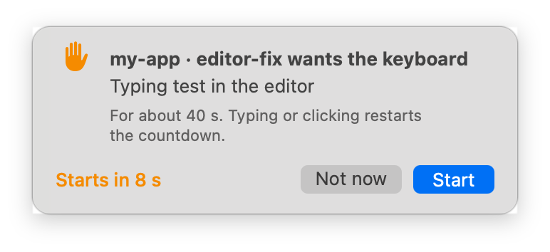
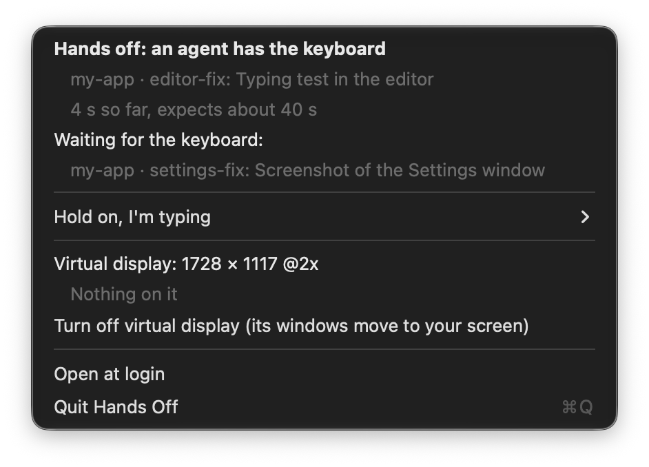

# Hands Off

**Let AI coding agents test your Mac apps while you keep working.**


Hands Off is a small menu bar app for people who let coding agents (Claude Code, Codex, Cursor and others) build and
test Mac apps. It gives the agents a **virtual display** for their test windows, and a **turn-taking system for the
keyboard**, so they stop popping windows over your work and stealing focus while you type. The menu bar shows when an
agent needs the keyboard, so you know when to let go.

## The problem

To test a Mac app, an agent has to launch it, click around, type into it and take screenshots. On your Mac, while you
are using it, that means:

- **Windows open on top of whatever you're doing.**
- **Keyboard focus moves while you're typing.** Half your sentence ends up in the app under test, or in nowhere.
- **Screenshots capture the wrong thing.** You take focus back, the agent's screenshot catches *your* editor, and it
  draws the wrong conclusion from it.
- **You can't tell when to stop.** There's no sign that an agent needs the keyboard for 30 seconds, or when it's done.

macOS has a single keyboard focus per login, so this can't be solved by just "being careful". Hands Off makes the
agents take turns with you instead:

| | What Hands Off does |
|---|---|
| Windows | Agents put their test windows on a virtual display off the corner of your screen. You never see them. |
| Screenshots | `handsoff screenshot` captures that display only, never your screens. |
| Keyboard | An agent that needs focus waits until you stop typing, then asks you. It starts after 10 s unless you say **Not now**, and the menu bar turns red: **Hands off 0:32**. |
| You touched it anyway | The agent is told its result can't be trusted, and runs the step again. |
| You need a minute | **Hold on, I'm typing** in the menu makes every agent wait. |

## Why I built it

I build Mac apps with several coding agents working at once, each on its own branch. Each of them builds the app,
launches it and tests it, on the same Mac I'm using to talk to them.

It kept going wrong in the same way. I'd be in the middle of typing a prompt to one agent, and another would pull
keyboard focus into the app it was testing. I'd click back to finish my sentence, and that agent's screenshot would
catch my windows instead of its app. Then it would "fix" a bug that didn't exist. The annoying part was that I'd have
happily let it have the keyboard for half a minute. I just had no way of knowing when it needed it.

### How it makes my life easier

- I don't see the test windows any more. They open on a display I never look at.
- When an agent needs the keyboard, it waits until I pause, and the menu bar says so. Red means take my hands off for a
  few seconds; when it goes back to the plain icon, the Mac is mine again.
- If I'm mid-thought, I click **Hold on, I'm typing** and every agent waits.
- If I forget and type anyway, the agent knows that result is bad and runs the step again. It no longer trusts a
  screenshot of my editor.

I now leave agents testing while I work, instead of sitting on my hands until they finish.

## What you'll see

| Menu bar | Meaning |
|---|---|
| Plain hand icon | Nothing needs the keyboard. Carry on. |
| **Agent needs keyboard** (orange) | An agent is waiting. It asks once you stop typing and clicking for 5 seconds. |
| **Agent starts in 0:08** (orange) | An agent is asking (see below). It starts when the countdown ends. |
| **Hands off 0:32** (red) | An agent has the keyboard. Let go until the countdown ends (`+0:05` means it's running over). |
| **Agents on hold 15m** | You chose *Hold on, I'm typing*. Agents wait until it runs out or you let them continue. |

Before each hold, a prompt under the icon says who's asking, why and for how long. It doesn't take the keyboard, so
you can keep typing, but each key press or click restarts its 10-second countdown: an agent never starts within 10
seconds of your last key. **Start** lets it go now. **Not now** makes agents wait 2 minutes, then the next one asks
again. If you don't answer, it starts when the countdown ends. With several agents in line, you're asked about one at
a time, and the prompt says how many more are waiting.



Don't want to be asked? Turn off **Ask before each hold** in the menu, or run `handsoff config confirm off`.

Click the icon to see who has the keyboard, why, and who is waiting:



## Set it up

You need macOS 14 or later and Xcode's command line tools (`xcode-select --install`). It's tested on macOS 27; earlier
versions should work but haven't been tried yet (reports welcome).

```sh
git clone https://github.com/harwal2000/hands-off.git
cd hands-off
scripts/install.sh
```

The install script builds the app and installs it to `~/Applications/Hands Off.app`. It also puts the `handsoff`
command in `~/.local/bin`, and starts the app. Make sure `~/.local/bin` is on your `PATH`, or pass `--bin-dir` to install
the command somewhere else. Then:

1. Click the hand icon in the menu bar and turn on **Open at login**.
2. Check it works: `handsoff status` should say "No agent needs the keyboard" and give the virtual display's size.

To update, `git pull` and run `scripts/install.sh` again. To remove it, run `scripts/install.sh --uninstall`.

## Tell your agent to use it

Paste this into your agent's instructions: `CLAUDE.md` for Claude Code (`~/.claude/CLAUDE.md` applies to every project),
`AGENTS.md` for Codex and others, or your tool's rules file.

```markdown
## Testing macOS apps: use Hands Off

The user works on this Mac while you test. When you run, drive or screenshot a macOS app, use `handsoff`
(see `handsoff --help`):

- **Windows go on the virtual display**, never on the user's screens. `handsoff display --appkit` prints its frame as
  `x y width height` in NSWindow coordinates; `handsoff display` gives JSON with CoreGraphics coordinates too.
- **Screenshots:** capture one window (`screencapture -l <windowID>`) or the virtual display
  (`handsoff screenshot <file.png>`). Never capture the whole screen.
- **Wrap every step that takes keyboard focus, activates an app, opens a menu or posts key or mouse events** in
  `handsoff focus --reason "<what, in plain words>" --seconds <estimate> -- <command>`
  (several steps: `-- sh -c '…'`). It waits until the user stops typing, asks them (it starts by itself after 10 s),
  shows "Hands off" in the menu bar, then runs the command. Build and prepare first, so you hold the keyboard only
  for the part that needs it. The reason and estimate are what the user sees when asked: make them plain and honest.
- **If the user says Not now, the command keeps waiting** (2 minutes, then it asks again). Don't cancel it, and give it
  a timeout of several minutes.
- **Exit code 75 means the user pressed a key or clicked during the hold** (or waiting gave up): the result can't be
  trusted. Run the step again. Never work around it with `--idle 0` or `--allow-input`.
- If `handsoff status` says the virtual display is off, ask the user before testing on their screens.
```

### Putting your app's windows on the virtual display

Your app decides where its windows open, so it has to put them there. The easiest way is a debug-only check at launch:
if Hands Off is running, open on its display.

```swift
#if DEBUG
/// The Hands Off virtual display's frame (NSWindow coordinates), while it's on.
func handsOffDisplayFrame() -> NSRect? {
    let file = URL.applicationSupportDirectory.appending(path: "Hands Off/display.json")
    guard let data = try? Data(contentsOf: file),
          let json = try? JSONSerialization.jsonObject(with: data) as? [String: Any],
          let f = json["appKit"] as? [String: Double] else { return nil }
    let frame = NSRect(x: f["x"]!, y: f["y"]!, width: f["width"]!, height: f["height"]!)
    // Only if that display is really connected (the file can outlive a crash).
    return NSScreen.screens.contains { $0.frame == frame } ? frame : nil
}
#endif

// …when showing a window:
#if DEBUG
if let display = handsOffDisplayFrame() { window.setFrameOrigin(NSPoint(x: display.minX + 80, y: display.maxY - window.frame.height - 80)) }
#endif
```

Or have the agent move an existing window there with whatever your app offers for it (a debug URL scheme or a test hook).

## Commands

```text
handsoff focus [options] -- <command> [args…]   Take the keyboard for one command (waits for the user first)
    --reason <text>   what it's doing, shown in the menu (default: the command)
    --seconds <n>     how long it expects to need, for the countdown
    --idle <n>        seconds without a key press or click before taking over (default 5)
    --wait <n>        give up after waiting this long (default 1800)
    --label <text>    who's asking (default: git repo and branch)
    --allow-input     for tools that post hardware-level events themselves (cliclick and the like)
handsoff display [--appkit | --cg]              The virtual display's frame
handsoff screenshot <file.png>                  Capture the virtual display only
handsoff status                                 What the menu bar shows, as text (including a prompt)
handsoff config confirm on|off                  Ask before each hold, or don't (on by default)
handsoff hold [minutes] / handsoff resume       Make agents wait / let them continue
handsoff quit-app                               Quit the menu bar app
```

An agent wrapping a step looks like this:

```console
$ handsoff focus --reason "Typing test in the editor" --seconds 40 -- ./ui-test.sh
handsoff: waiting: the user is typing or clicking (takes over after 5 s without)
handsoff: asking the user first: starts in 10 s unless they say Not now (keys and clicks restart the countdown)
handsoff: you have the keyboard: Typing test in the editor
...test output...
$ echo $?
0
```

Several agents queue for the keyboard: each waits for the one before it. Calls nested inside a `handsoff focus` command
reuse the hold instead of waiting for themselves.

## How it works

- **One app, two faces.** `Hands Off.app` is the menu bar app when you open it, and the `handsoff` command when it's run
  with a subcommand. The two share a few small files in `~/Library/Application Support/Hands Off/`, so the command works
  even while the app is starting up.
- **The virtual display** uses macOS's private `CGVirtualDisplay` API, the same one DeskPad and BetterDisplay use.
  It has your main display's size and Retina scale, so apps lay out the same as on your screen. It sits diagonally off
  the corner of your main display, touching it at a single point, so your pointer doesn't wander onto it. The arrangement
  is temporary: quit Hands Off and your displays are exactly as before, with any windows on it moved back to your screen.
- **"Touched the keyboard"** means a key press or mouse click from real hardware, read from the system's input state.
  It needs no permission. Moving the mouse doesn't count, because it doesn't move focus. Events that apps post
  themselves don't count either.
- **The prompt** is a panel that can't become the key window and doesn't activate the app, so it never takes the
  keyboard. Only one agent asks at a time (a lock file, like the keyboard's). Not now is a 2-minute "Hold on". The
  command doesn't ask when the menu bar app isn't running, since nobody could answer.
- **The keyboard lock** is a file that's created atomically. A lock left behind by an agent that crashed or was killed is
  ignored, and if an agent is interrupted, its command is stopped and the keyboard let go.

## Limits

- **It's turn-taking, not isolation.** Agents still use your Mac's one keyboard focus, just not while you're typing. For
  complete isolation, test in a macOS virtual machine.
- **It uses a private API.** `CGVirtualDisplay` has been around since macOS 10.14 and works on macOS 27, but Apple could
  change it.
- **Tools that post hardware-level events** (`cliclick`, some UI-test runners) look like you touching the keyboard. Pass
  `--allow-input` for them.
- **Tests that need focus still fail while your screen is locked.** That's macOS, not Hands Off.

## Development

```sh
swift test                       # the turn-taking rules and shared state
scripts/build-app.sh             # → build/Hands Off.app
scripts/readme-media/record.sh   # re-records docs/menubar.gif and docs/menu.png
```

To try a build without touching the installed app, give a copy its own bundle identifier (its `Info.plist`) and its own
state folder, and run its executable directly:

```sh
HANDSOFF_STATE_DIR=/tmp/ho-test HANDSOFF_VIRTUAL_DISPLAY=off HANDSOFF_PROMPT_AT="100 800" \
  "/tmp/Hands Off Test.app/Contents/MacOS/HandsOff" &          # the menu bar app: no second virtual display
HANDSOFF_STATE_DIR=/tmp/ho-test "/tmp/Hands Off Test.app/Contents/MacOS/HandsOff" focus -- sleep 2
```

`HANDSOFF_PROMPT_AT` puts the prompt's top left corner somewhere else (AppKit coordinates), e.g. on the virtual display.

## Support

If Hands Off saves you some frustration, you can buy me a coffee:

<a href="https://buymeacoffee.com/harshilagarwal"></a>

Issues and pull requests are welcome.

MIT licensed.
