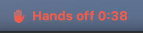
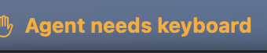
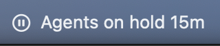

# Hands Off

**Let coding agents test Mac apps without fighting you for the keyboard.**

Agents that test Mac apps open windows on your screen and grab keyboard focus while you're typing. Grab it
back and their screenshots catch *your* windows instead of the app. Hands Off is a small menu bar app that
fixes both:

- **A virtual display for the agents' windows.** It sits off the corner of your screen where your pointer won't
  go. Agents put their test windows there and screenshot them; you never see them.
- **Turn-taking for the keyboard.** macOS has one keyboard focus, so an agent that needs it wraps the step in
  `handsoff focus`. It waits until you stop typing, the menu bar turns red ("Hands off 0:32"), and if you press a
  key or click anyway, the agent is told its result can't be trusted and runs it again.

| Menu bar | Meaning |
|---|---|
| Icon only | Nothing needs the keyboard. Carry on. |
| **Agent needs keyboard** (amber) | An agent is waiting. It takes over once you stop typing and clicking for 5 seconds. |
| **Hands off 0:32** (red) | An agent has the keyboard. Let go until it's done. |
| **Agents on hold 15m** | You chose *Hold on, I'm typing*; agents wait. |





The menu shows who is waiting and why, and lets you hold agents off for 5 minutes, 15 minutes or an hour.

## Install

Needs macOS 14 or later and the Xcode command line tools (Swift 6).

```sh
git clone <this repo> hands-off
cd hands-off
scripts/install.sh            # → ~/Applications/Hands Off.app and ~/.local/bin/handsoff
```

Then turn on **Open at login** in its menu. `scripts/install.sh --uninstall` removes it.

## Use it from an agent

```sh
# Where to put test windows (AppKit coordinates: NSWindow frames, y up from the main display's bottom)
handsoff display --appkit          # → 1728 -1117 1728 1117   (x y width height)
handsoff display                   # the same as JSON, with CoreGraphics coordinates and scale too

# Anything that takes keyboard focus or posts key events
handsoff focus --reason "typing test" --seconds 40 -- xcodebuild test -scheme MyAppUITests
handsoff focus -- sh -c 'open -a MyApp && ./drive-ui.sh && screencapture -l "$WINDOW_ID" shot.png'

# A screenshot of the virtual display only
handsoff screenshot /tmp/shot.png
```

`handsoff focus` exits with the command's status, or **75** when you touched the keyboard or mouse buttons
during the hold (or it gave up waiting, after 30 minutes by default). Nested calls reuse the outer hold.
`handsoff --help` lists every option.

### A note for your agents' instructions

Paste into `CLAUDE.md` / `AGENTS.md`:

> **The user works on this Mac while you test.** Put any window you open for testing on the Hands Off virtual
> display (`handsoff display --appkit` gives its frame) and capture windows or that display, never the whole
> screen. Wrap every step that takes keyboard focus, activates an app or posts key events in
> `handsoff focus --reason "<what>" --seconds <estimate> -- <command>`, and keep those steps short. If it exits
> with 75, the user touched the keyboard: run the step again.

## How it works

- One executable inside `Hands Off.app`: launched normally it's the menu bar app; with a subcommand it's the
  `handsoff` command. They share small JSON files in `~/Library/Application Support/Hands Off/`.
- The virtual display uses CoreGraphics' private `CGVirtualDisplay` API (as DeskPad and BetterDisplay do), at
  your main display's size and scale. It's positioned for this app only, so quitting puts your display arrangement
  back as it was, and its windows move to your screen.
- "Touched the keyboard" means a key press or mouse click from real hardware, read from the HID event state (no
  permission needed). Mouse movement doesn't count; it doesn't move focus.
- The keyboard lock is a file created atomically; a lock left by a process that died is ignored.

## Limits

- **It's a turn-taking system, not isolation.** The agent still uses your Mac's one keyboard focus. For full
  isolation, test in a macOS VM.
- **Private API.** `CGVirtualDisplay` works on macOS 14 through 27 but Apple could change it.
- **Tools that post hardware-level events** (`cliclick`, some UI-test runners) look like you touching the
  keyboard. Pass `--allow-input` for those.
- Tests that need focus still fail while the screen is locked.

## Development

```sh
swift test                 # the turn-taking rules and shared state
scripts/build-app.sh       # → build/Hands Off.app
```

MIT licensed.
